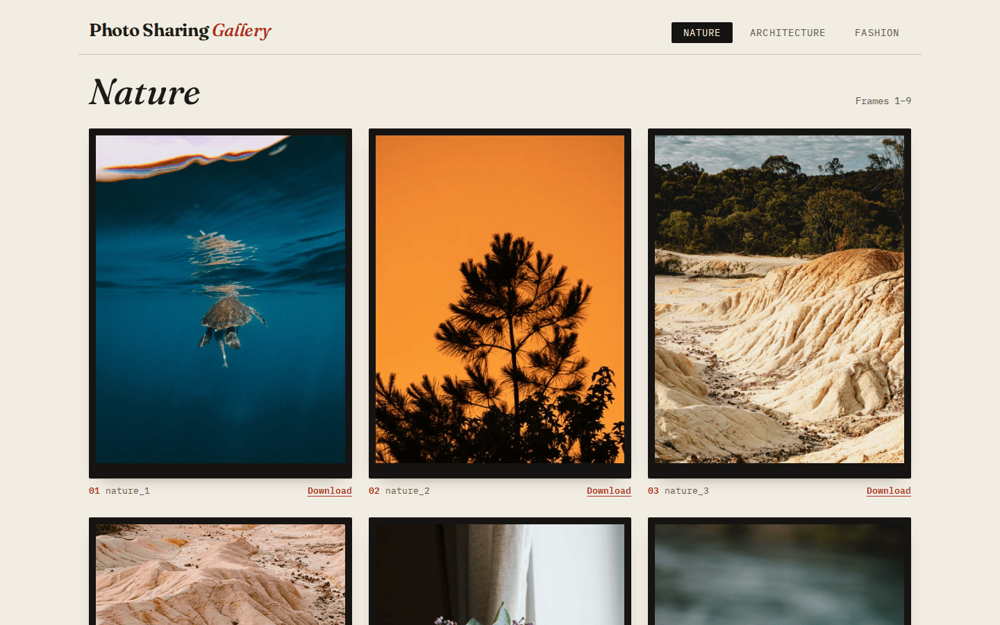
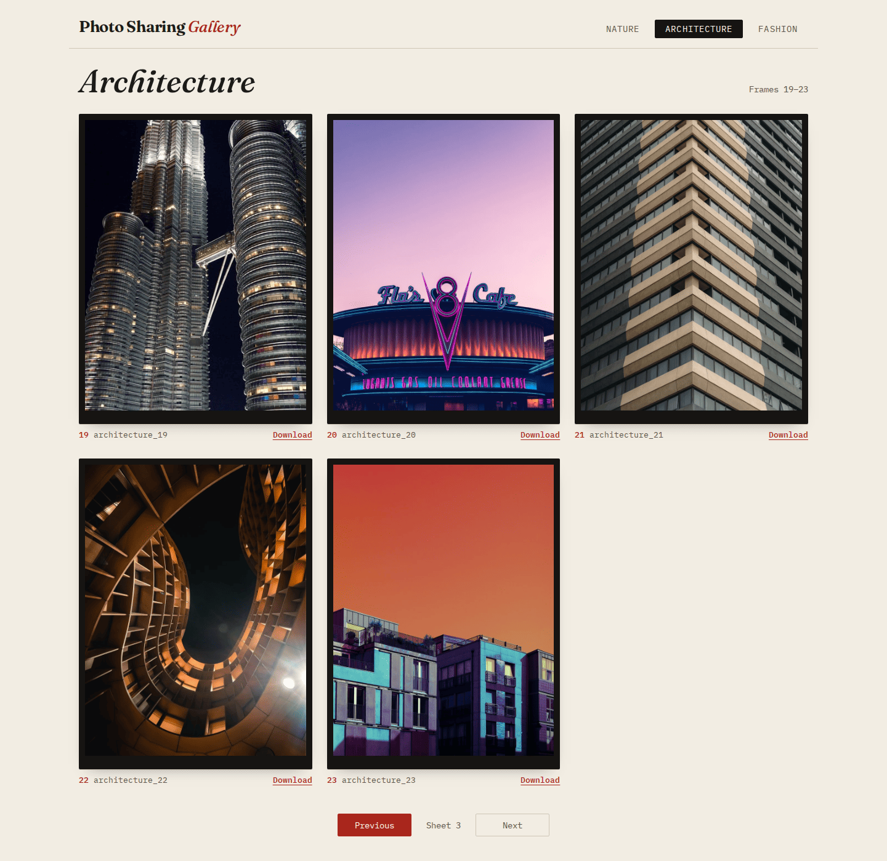
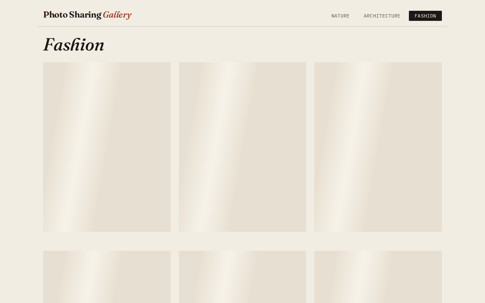
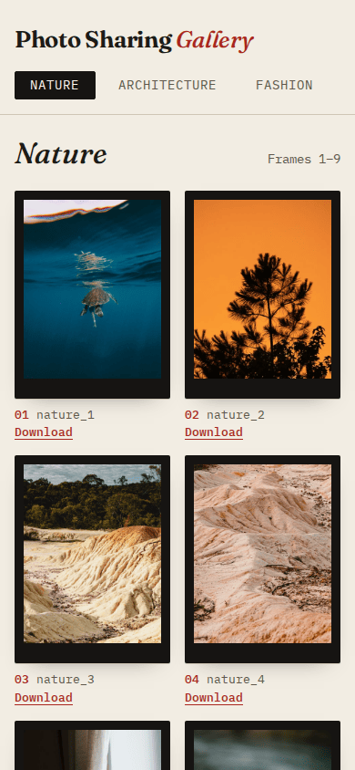
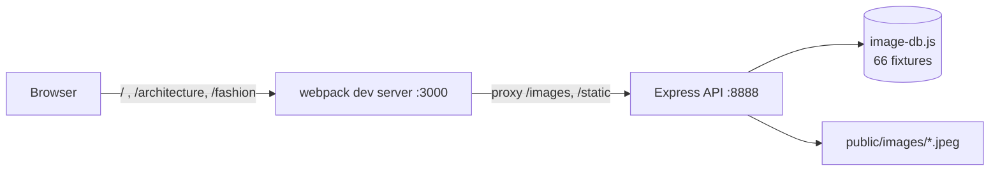

# Photo Sharing Gallery

A React gallery for three collections of stock photos (nature, architecture,
fashion) that you can page through and download. It started as a refactoring
exercise: the React client was given in poor shape, next to a small Express
API that was off limits. The API returns only **three images per request** and
waits **three seconds** before answering. Under those limits the client has
to fill a nine-photo screen, page cleanly through a category and handle slow
or failed loads.



| Last sheet of a category | Loading | Mobile |
| --- | --- | --- |
|  |  |  |

## The two folders

The folder names come from the exercise brief and are kept so the history
still reads against it:

- `src/refactor-this/` is the React client, open to any change.
- `src/do-not-refactor/` is the supplied image API (`server.js`, `config.js`,
  `image-db.js`) and its 66 JPEG fixtures. The brief treats it as a fixed
  contract.

The API contract is unchanged: `GET /images?category=&page=` still returns
up to three `{ category, name, url }` objects, and images are still served
from `/static`. The server got only three small changes:

- Malformed input now gets a `400` response. Before, `page=-1` sliced from
  the end of the list and returned real photos, and `page=abc` or an unknown
  category returned an empty page that looked like the end of the data.
- The app is exported, so tests can start it on a random port.
- `LATENCY_MS` and `API_PORT` can override the simulated delay and the port.

`image-db.js` is untouched.

## Running it

### Docker

```bash
docker compose up --build
```

Open <http://localhost:3000>. The image installs dependencies at build time
and runs as the unprivileged `node` user. To pick another host port or skip
the simulated delay:

```bash
PORT=8080 LATENCY_MS=0 docker compose up --build
```

### Node

Requires Node 22.15 or later (`.nvmrc` pins 22).

```bash
npm ci
npm start
```

`npm start` uses `concurrently` to run the API on :8888 (`node --watch`) and
the webpack dev server on :3000. Open <http://localhost:3000>.

| Script | What it does |
| --- | --- |
| `npm start` | API and dev server together |
| `npm run start:api` / `start:web` | each half on its own |
| `npm test` | Jest: client components, API client and the Express server |
| `npm run lint` | ESLint 9 with React and React Hooks rules |
| `npm run build` | production bundle in `dist/` |

| Variable | Default | Used by |
| --- | --- | --- |
| `LATENCY_MS` | `3000` | API: simulated response delay |
| `API_PORT` | `8888` | API: listen port, also used in the image URLs it returns |
| `API_URL` | `http://localhost:8888` | dev server: where to proxy `/images` and `/static` |
| `HOST` | `localhost` | dev server: bind address (`0.0.0.0` in Docker) |
| `PORT` | `3000` | Compose only: host port to publish |

## How it works



The browser only talks to port 3000. The API returns absolute
`http://localhost:8888/...` image URLs, and the client keeps only their path,
so the images also come through the proxy. This matters for downloads:
browsers ignore `<a download>` on a cross-origin link and just open the
image. It also means no API host is compiled into the bundle.

One screen ("sheet") shows nine photos, which takes three API pages. The
client sends a fourth request at the same time for the first page of the
next sheet. **Next** is enabled only if that page has photos. Without this
check, a category with exactly 9, 18, … photos would leave Next enabled on
a final sheet with nothing on it. All four requests run in parallel, so the
check adds no wait. The requests are aborted when you leave the screen, and
Previous/Next stay disabled while a sheet loads.

```text
GET /images?category=nature&page=7
[{"category":"nature","name":"nature_19","url":"http://localhost:8888/static/images/nature/nature_19.jpeg"},
 {"category":"nature","name":"nature_20","url":"http://localhost:8888/static/images/nature/nature_20.jpeg"},
 {"category":"nature","name":"nature_21","url":"http://localhost:8888/static/images/nature/nature_21.jpeg"}]

GET /images?category=nature&page=-1
HTTP/1.1 400 Bad Request
{"error":"page must be an integer between 1 and 10000"}
```

Other states the client handles:

- **Failed load:** an alert with a **Try again** button, instead of an empty
  grid.
- **Empty page:** says so.
- **Unknown route:** a not-found page.

## Design

The client is styled as a darkroom contact sheet:

- warm paper background
- each photo in a black film frame, with a numbered caption in IBM Plex Mono
- Fraunces italic for headings
- one safelight red for links and actions

The sheet has three columns on desktop and two on phones. Category tabs stay
visible at every width; the old Bootstrap navbar hid them below 992px. The
download link is always visible instead of appearing only on hover, so it
also works on touch screens and with a keyboard. Each link is labelled per
photo ("Download Nature photo 4").

## Stack

React 19, React Router 7, webpack 5 with Babel, Express 5, and Jest 30 with
Testing Library. The client uses `fetch` rather than axios.

## Limitations

- `npm run build` produces a static `dist/`, but the repo has no production
  server: whatever serves `dist/` must also forward `/images` and `/static`
  to the API, as the dev server does.
- The API keeps its exercise behaviour: an in-memory list, three items per
  request and a fixed delay. There is no upload endpoint.

## Photos

The 66 JPEGs in `src/do-not-refactor/public/images/` came with the exercise.
They carry no EXIF or credit metadata, and neither the exercise nor this repo
says where they come from or under what licence. Treat them as placeholder
fixtures, not as material you are free to reuse. The MIT licence in
`LICENSE` covers the code only.
